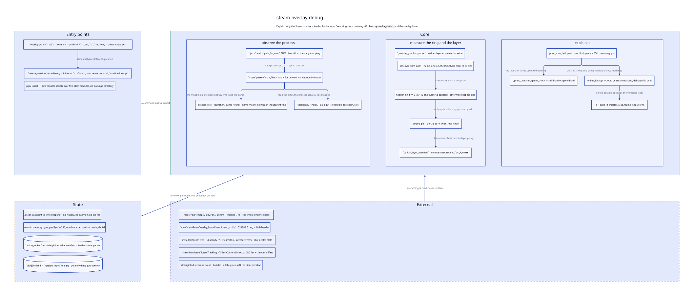

# steam-overlay-debug

A read-only inspector for the Linux Steam overlay: it identifies which `gameoverlayrenderer.so` build a process has mapped, how the overlay was injected, and whether the `GameOverlay_InputEventStream` ring is still being drained — the failure in [steam-for-linux#11446](https://github.com/ValveSoftware/steam-for-linux/issues/11446).

Read it left to right:

- **Identity comes from the mapped file, not the path.** `overlay-scan` reads `/proc/<pid>/maps`, dedupes segments by `(dev, inode)`, and reads the bytes through `/proc/<pid>/map_files/<vma>` — the on-disk path is often gone or marked ` (deleted)` after a Steam update, so the file the process actually has is the only trustworthy copy. `version.py` then parses PE (UTF-16 FileVersion plus a `steam_rel_client*_win64` branch string) or ELF (`.note.gnu.build-id`, a `.comment` SteamRT/mold fingerprint, `.gnu_debuglink`) and derives the deploy slot from the path.
- **The ring is found by shape and then validated, not by name.** `discover_shm_path` tries the canonical `/dev/shm/GameOverlay_InputEventStream_<pid>`, then any writable `/dev/shm` mapping of exactly 524304 or 524288 bytes, then a process fd of that size — because Proton/Wine renames the ring to `u1000-Shm_*`. A same-size map only counts if header `kind == 2` at byte +16 and the write cursor is within capacity, which is what keeps an unrelated buffer from being reported as an event ring.
- **The diagnostic is a rate, not a value.** `probe_pid` reads the uint32 at offset +4, waits `--shm-sample-sec`, and reads it again; healthy idle overlays creep forward (the frame heartbeat), while #11446 shows a flat cursor on idle that only rises when you move the mouse or press a key. A negative delta is treated as a wrap to the second reading.
- **The launcher is the usual red herring.** A launch shell maps the overlay too — often a stale 32-bit `ubuntu12_64` preload on the reaper step — so `_process_role` only calls a process a game when it owns a validated ring and is not a shell/`reaper`/Wine helper; `_print_launcher_game_check` then compares the shell's build id with the game's and says plainly when the preload did not reach the game.
- **Online checks are a cross-check, never the verdict.** `online_lookup` matches the binary's CRC32 against SteamTracking's `ClientContentLinux.txt` (one snapshot, no history), reports whether your installed client build is older/newer/same than that snapshot, and probes `debuginfod.steamos.cloud` by Build ID — which 404s for client overlays on purpose, since only SLR/SteamOS packages are published there.

Diagram source: [`docs/system.d2`](docs/system.d2) · renderer: [`scripts/render-diagram.sh`](scripts/render-diagram.sh).
